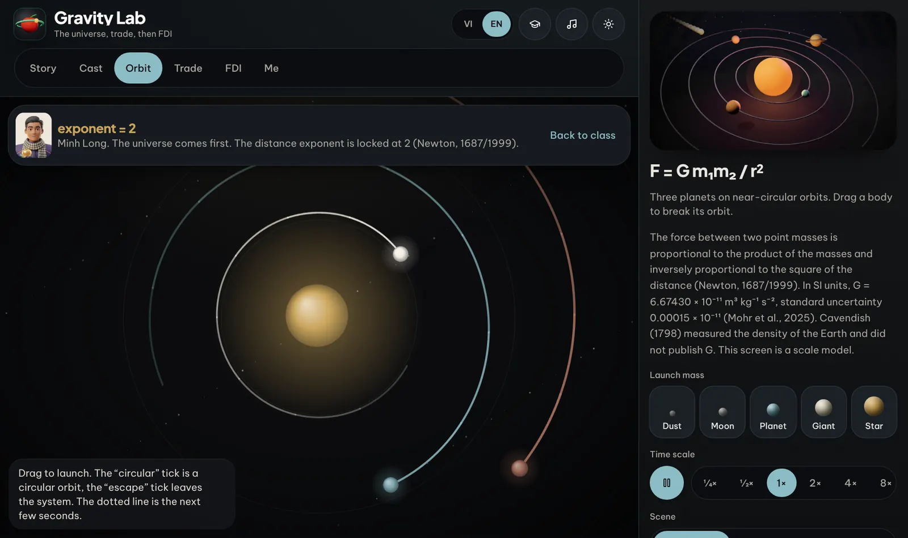
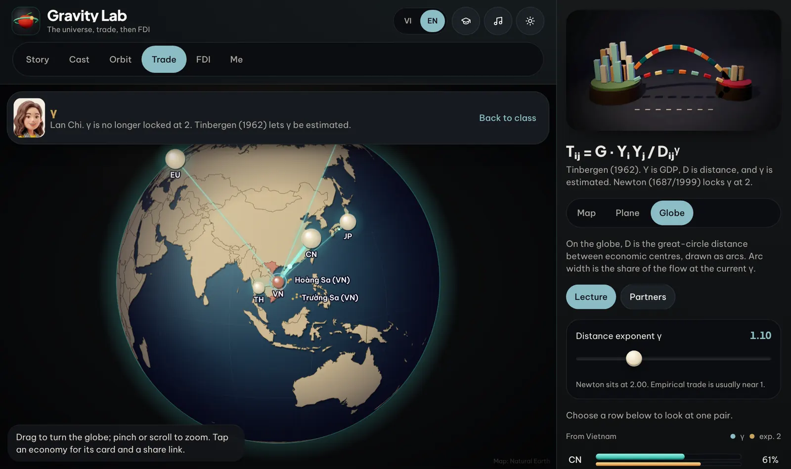
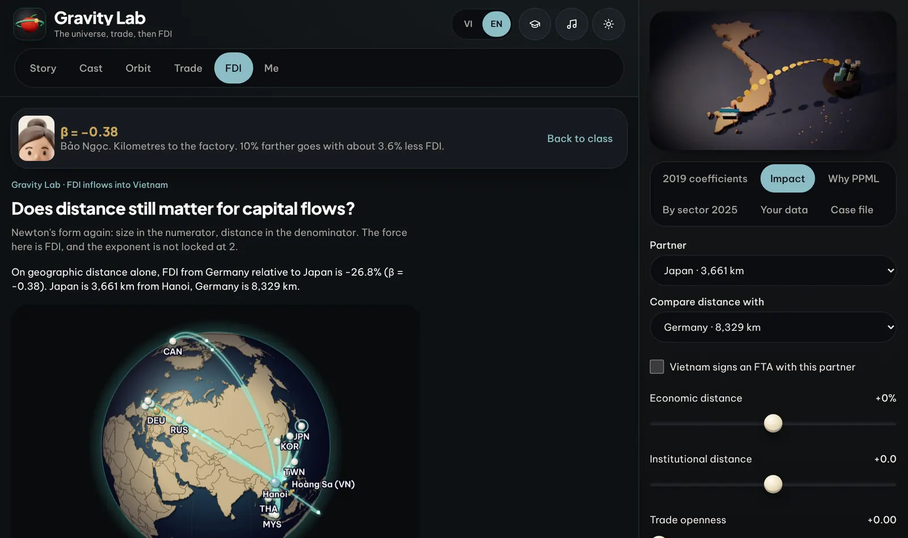
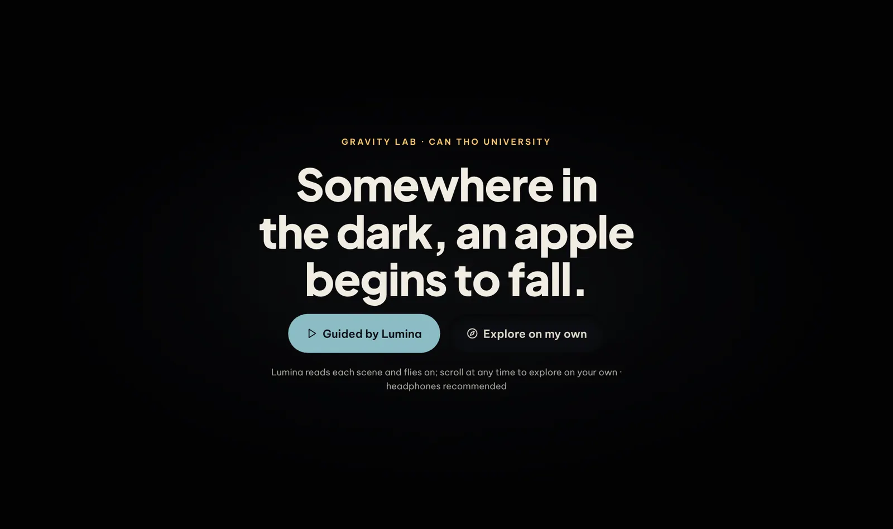

<div align="center">

# Gravity Lab

### From Newton's apple to FDI in Viet Nam: an interactive laboratory for the gravity model

[](https://doi.org/10.5281/zenodo.23307832)

[](https://github.com/thuyhuongctu/Gravity-Lab/actions/workflows/pages.yml)


**[Open the app](https://thuyhuongctu.github.io/Gravity-Lab/)** ·
[Trailer](https://thuyhuongctu.github.io/Gravity-Lab/trailer/gravity-lab-trailer.mp4) ·
[Cite](#how-to-cite) ·
[Features](#whats-inside) ·
[The model](#the-model-in-six-equations) ·
[Run locally](#run-locally) ·
[Privacy](https://thuyhuongctu.github.io/Gravity-Lab/privacy/)

<a href="https://thuyhuongctu.github.io/Gravity-Lab/trailer/gravity-lab-trailer.mp4"></a>

<sub><b>Watch the 60-second trailer</b> (1080p, English voice-over with the theme song): <a href="https://thuyhuongctu.github.io/Gravity-Lab/trailer/gravity-lab-trailer.mp4">play in the browser</a></sub>

</div>

Gravity Lab is a bilingual teaching app for the gravity model in international economics and international business. Students follow one equation from Newtonian mechanics to the empirical study of trade and foreign direct investment (FDI), and then estimate it on real data. Everything runs in the browser, on the student's own device.

> **Authors.** Phan Anh Tu ([ORCID 0000-0003-0667-3137](https://orcid.org/0000-0003-0667-3137), patu@ctu.edu.vn) and Do Thuy Huong ([ORCID 0000-0002-7711-2487](https://orcid.org/0000-0002-7711-2487), thuyhuongctu@gmail.com), School of Economics, Can Tho University, Viet Nam.

## What's inside

| Room               | What the learner does                                                                                                                                    |
|--------------------|----------------------------------------------------------------------------------------------------------------------------------------------------------|
| **Story**          | Flies through nine 3D scenes, from Newton's apple (1666) to FDI into Viet Nam. Lumina can guide the tour scene by scene, or the learner explores freely. |
| **Orbit**          | Launches bodies in an N-body simulator of Newton's law, where the distance exponent is fixed at 2 (Newton, 1687/1999).                                   |
| **Trade**          | Drags the distance elasticity γ on a world map, a plane or a globe and watches Viet Nam's trade flows re-route (Tinbergen, 1962).                        |
| **FDI**            | Reads the published coefficients for FDI into Viet Nam (Phan & Do, 2019), runs impact scenarios and case files, and views FDI by sector.                 |
| **Formula bridge** | Walks seven interactive steps from F = G·m₁m₂/r² to the FDI specification, including simulations of multilateral resistance and of OLS versus PPML.      |
| **Pro (free)**     | Loads a CSV panel or the bundled Viet Nam FDI panel, estimates OLS and PPML on the device, runs six model checks and exports a Word or LaTeX table.      |
| **Me**             | Keeps story progress and settings, and offers six self-marked exercises with a teacher mode.                                                             |

<table>
  <tr>
    <td width="50%"><br><sub><b>Orbit.</b> Newton's law with a live N-body simulation.</sub></td>
    <td width="50%"><br><sub><b>Trade.</b> Tinbergen's model on a globe, with γ to estimate.</sub></td>
  </tr>
  <tr>
    <td width="50%"><br><sub><b>FDI.</b> Published coefficients and an impact calculator.</sub></td>
    <td width="50%"><br><sub><b>Start.</b> Two ways in: guided by Lumina, or explore on your own.</sub></td>
  </tr>
</table>

### Built for the classroom

- **Two languages, one switch.** The interface opens in English. Vietnamese is a full translation that keeps the English technical terms in brackets, and visitors on Vietnamese devices are offered it on their first visit. Use the VI/EN switch or `?lang=vi`.
- **Lumina, an offline teaching assistant.** Lumina narrates each scene with recorded voice and answers questions from a curated bilingual knowledge base. Retrieval uses BM25, every answer lists its sources, and questions without a source are declined rather than guessed. No generative model is used (`src/sim/tutor.ts`, `src/sim/tutor-kb.ts`).
- **Explains the student's own results.** After an estimation, Lumina reads the coefficients back in plain language and flags the six model checks: multilateral resistance, flow direction, deflation, zero flows, the confidence interval and domestic flows.
- **Ready to cite.** APA 7 references appear in every room, exported tables carry them, and each version has a Zenodo DOI.
- **Theme song and sonification.** A theme song in both languages, with lyrics, and an orbit simulator you can hear, where inner orbits sound higher as Kepler's third law implies (Kepler, 1619/1997).
- **Light and dark themes, reduced motion and keyboard access.** Key screens are checked with axe against WCAG 2 A and AA.

### Private by design

No account, no analytics, no cookies and no advertising. CSV files and questions to Lumina never leave the device. The app installs as a progressive web app and works offline after the first visit. See the [privacy policy](https://thuyhuongctu.github.io/Gravity-Lab/privacy/).

## The model in six equations

Students often meet the gravity equation as a regression specification without seeing what its terms mean or why it takes its form. Gravity Lab treats it as one object that keeps its form across disciplines while its meaning changes. Each stage changes one element: the meaning of mass, the exponent on distance, the treatment of zero flows, or the dependent variable. The learner then sees the consequence directly.

Newton's law of universal gravitation, with the distance exponent fixed at two:

$$F = G\,\frac{m_1 m_2}{r^2}$$

The gravity model of trade, in which economic size replaces mass and the exponents are estimated (Tinbergen, 1962):

$$T_{ij} = G\,\frac{Y_i^{\beta_1}\,Y_j^{\beta_2}}{D_{ij}^{\gamma}}$$

The log-linear form, estimated by ordinary least squares:

$$\ln T_{ij} = \beta_0 + \beta_1 \ln Y_i + \beta_2 \ln Y_j - \gamma \ln D_{ij} + \varepsilon_{ij}$$

The structural gravity model with multilateral resistance terms (Anderson & van Wincoop, 2003):

$$T_{ij} = \frac{Y_i Y_j}{Y_W}\left(\frac{t_{ij}}{\Pi_i P_j}\right)^{1-\sigma}$$

The exponential form estimated by PPML, which retains zero flows and remains consistent under heteroskedasticity (Santos Silva & Tenreyro, 2006):

$$T_{ij} = \exp\left(\beta_0 + \beta_1 \ln Y_i + \beta_2 \ln Y_j - \gamma \ln D_{ij}\right)\eta_{ij}$$

The FDI specification for Vietnam, with institutional, cultural and economic distance in $X_{it}$ and a source-country random effect $u_i$ (Phan & Do, 2019):

$$\ln \mathit{FDI}_{it} = \beta_0 + \beta_1 \ln Y_{it} + \beta_2 \ln Y_{VN,t} - \gamma \ln D_{i,VN} + \delta' X_{it} + u_i + \varepsilon_{it}$$

<details>
<summary><b>Estimation practice taught in the app</b></summary>

Two WTO and UNCTAD guides frame the estimation practice taught in the application: Bacchetta et al. (2012) on the "gold, silver and bronze medal" mistakes and on fixed effects for multilateral resistance, and Yotov et al. (2016) on structural gravity with panel data, intra-national trade, exporter-time, importer-time and pair fixed effects, and PPML. The Story page reproduces their resolution of the "distance puzzle" (Table 2). Majumdar and Basu (2023) augment the equation with an exchange-rate uncertainty index and the real exchange rate for India's trade with its top five partners and the SAARC countries; the Story page uses the study to show why time-invariant distance cannot be identified under country-pair fixed effects. The meta-analysis of Disdier and Head (2008) is used as a benchmark for the distance elasticity in trade, with a mean near 0.9. In Phan and Do (2019), the coefficient on geographic distance for FDI inflows into Vietnam is approximately −0.38 from Model 4 onwards.

</details>

## Run locally

Gravity Lab is a static single-page app built with React 19, TypeScript, Vite, Tailwind CSS 4, three.js and KaTeX. It needs Node.js 22 or later.

```sh
npm install
npm run dev        # development server at http://localhost:8080
npm run build      # static build in dist/
npm run typecheck  # TypeScript
npm run lint       # ESLint
npm test           # unit tests (node:test)
```

The build uses relative paths, so it runs from any static host. Each push to `main` deploys to GitHub Pages through `.github/workflows/pages.yml`.

```text
src/components/   rooms, the 3D journey, the formula bridge and the Pro lab
src/sim/          models and estimators: OLS, PPML, diagnostics, exercises, Lumina's retrieval
src/lib/          preferences, sound, sharing and the 3D scene
src/data/         simplified country outlines (Natural Earth)
public/           narration, music, artwork, the trailer, the service worker and the privacy page
scripts/          map, clay-render and data build scripts
script/android/   one-command Android (Trusted Web Activity) build
docs/             recording guide for Lumina's voice and README screenshots
```

**Android.** `script/android/build.sh` packages the web app as a Trusted Web Activity for Google Play with Bubblewrap. See [`ANDROID.md`](ANDROID.md) and the store listing in [`store/listing.md`](store/listing.md).

## How to cite

Please cite the version you used. The concept DOI **[10.5281/zenodo.23307832](https://doi.org/10.5281/zenodo.23307832)** covers all versions and resolves to the latest release.

> Phan, A. T., & Do, T. H. (2026). *Gravity Lab: A browser-based gravity-model laboratory for FDI into Vietnam* (Version v2.9) [Computer software]. Zenodo. https://doi.org/10.5281/zenodo.23373182

```bibtex
@software{phan_do_2026_gravity_lab,
  author    = {Phan, Anh Tu and Do, Thuy Huong},
  title     = {Gravity Lab: A browser-based gravity-model laboratory for FDI into Vietnam},
  version   = {v2.9},
  year      = {2026},
  publisher = {Zenodo},
  doi       = {10.5281/zenodo.23373182},
  url       = {https://doi.org/10.5281/zenodo.23373182}
}
```

<details>
<summary><b>DOIs of every version</b></summary>

| Version | DOI                                                                |
|---------|--------------------------------------------------------------------|
| v2.9    | [10.5281/zenodo.23373182](https://doi.org/10.5281/zenodo.23373182) |
| v2.8    | [10.5281/zenodo.23330642](https://doi.org/10.5281/zenodo.23330642) |
| v2.7    | [10.5281/zenodo.23327722](https://doi.org/10.5281/zenodo.23327722) |
| v2.6    | [10.5281/zenodo.23316154](https://doi.org/10.5281/zenodo.23316154) |
| v2.5    | [10.5281/zenodo.23314720](https://doi.org/10.5281/zenodo.23314720) |
| v2.4    | [10.5281/zenodo.23314318](https://doi.org/10.5281/zenodo.23314318) |
| v2.3    | [10.5281/zenodo.23313162](https://doi.org/10.5281/zenodo.23313162) |
| v2.2    | [10.5281/zenodo.23308587](https://doi.org/10.5281/zenodo.23308587) |
| v2.1    | [10.5281/zenodo.23308307](https://doi.org/10.5281/zenodo.23308307) |
| v2.0    | [10.5281/zenodo.23308130](https://doi.org/10.5281/zenodo.23308130) |
| v1.0    | [10.5281/zenodo.23307833](https://doi.org/10.5281/zenodo.23307833) |

</details>

Complete metadata are in [`CITATION.cff`](CITATION.cff). From v2.3 onwards the files deposited on Zenodo can be downloaded openly for reading, consultation and citation. Earlier versions were deposited with restricted access. Open access to the files does not change the licence.

## Sources of data, artwork and sound

<details>
<summary><b>Maps, figures, characters, music, typefaces and constants</b></summary>

- **Country outlines** come from Natural Earth (`ne_10m_admin_0_countries`, public domain), simplified by `scripts/build-land.py` into `src/data/land.ts`.
- **Map of Vietnam.** The coastline uses the Natural Earth 1:50m outline (`scripts/vn-map/vnm.json`). The Hoàng Sa (Paracel) and Trường Sa (Spratly) archipelagos are placed from the coordinates of their principal features. The map appears in two forms: a faint background layer (`scripts/vn-map/build.py`) and a clay rendering.
- **Clay illustrations.** The map of Vietnam, the Newton scene, the room covers and the application icon are rendered with three.js in a "clay noir" style: a single warm spotlight, a cool rim light, vignette and film grain. The scenes and instructions for re-rendering them are in `scripts/clay-noir/`.
- **Historical figures.** The clay figure of Isaac Newton follows Godfrey Kneller's 1689 portrait, which is in the public domain. The figure of Jan Tinbergen is a stylised tribute and is not based on any single photograph. Both figures, and the illustration of the two at a blackboard, were created for this application. The chalk in that illustration shows a simplified form of the equations; the application states the full specifications in text.
- **Characters.** The class characters come from the BizOn clay library and belong to the authors (see [`LICENSE`](LICENSE)). Their spacesuit figures, portraits and classroom scenes (`public/cast/suit`, `public/cast/astro`, `public/scene`) were generated by the authors with an AI image tool from the original characters.
- **Sound.** The ambience, orbit sonification and planetary tones are generated at run time with the Web Audio API by code written for this application (`src/lib/sound.ts`); they use no samples or third-party compositions. The musical elements used (an open fifth, a pentatonic scale, octave transposition) are common knowledge. The planetary tones are computed from published orbital periods, which are facts and are cited.
- **Theme song.** The song exists in two versions: *Từ một quả táo rơi* (Vietnamese, 5:13) and *Gravity Lab — From an Apple to the Stars* (English, 5:53). Both retell the path from Newton to Tinbergen, PPML and FDI into the Mekong Delta. The lyrics were written by the authors; the music was generated by the authors with an AI music tool from those lyrics and a style description. The recordings (`public/music/`) are streamed only when the listener presses play, and the lyrics of both versions are shown in the sound panel (`src/lib/song.ts`).
- **Trailer.** The 60-second English trailer (`public/trailer/`) is rendered frame by frame from the authors' design files, using the app's own artwork and screenshots. The voice-over was recorded by the authors. The background music is the English theme song, mixed about 15 dB below the voice and lowered further under speech. The trade shares shown in the Trade scene are illustrative and labelled as such. A copyright line runs in the lower-right corner throughout, and the closing scene carries the full notice: © 2026 the authors, School of Economics, Can Tho University, all rights reserved.
- **Typefaces.** Plus Jakarta Sans and Be Vietnam Pro are self-hosted under the SIL Open Font License 1.1 (`src/fonts/OFL.txt`).
- **Physical constants.** CODATA 2022 values are used (Mohr et al., 2025). Planetary periods are taken from the NASA Planetary Fact Sheet (Williams, n.d.).

</details>

**Provenance.** This repository is a standalone edition of Gravity Lab, separated from the [BizOn](https://github.com/thuyhuongctu/BizOn) teaching ecosystem for academic archiving and an independent DOI. An earlier static HTML version remains at https://thuyhuongctu.github.io/BizOn/lab/gravity-lab.html and in the git history (commit `9ee11a1`).

## References

Anderson, J. E., & van Wincoop, E. (2003). Gravity with gravitas: A solution to the border puzzle. *American Economic Review, 93*(1), 170–192. https://doi.org/10.1257/000282803321455214

Bacchetta, M., Beverelli, C., Cadot, O., Fugazza, M., Grether, J.-M., Helble, M., Nicita, A., & Piermartini, R. (2012). *A practical guide to trade policy analysis*. World Trade Organization; United Nations Conference on Trade and Development. https://www.wto.org/english/res_e/publications_e/wto_unctad12_e.htm

Disdier, A.-C., & Head, K. (2008). The puzzling persistence of the distance effect on bilateral trade. *The Review of Economics and Statistics, 90*(1), 37–48. https://doi.org/10.1162/rest.90.1.37

Kepler, J. (1997). *The harmony of the world* (E. J. Aiton, A. M. Duncan, & J. V. Field, Trans.). American Philosophical Society. (Original work published 1619)

Majumdar, D., & Basu, S. (2023). Exchange rate uncertainty and India's bilateral trade: A gravity model approach. *Arthaniti: Journal of Economic Theory and Practice*. Advance online publication. https://doi.org/10.1177/09767479231178953

Mohr, P. J., Newell, D. B., Taylor, B. N., & Tiesinga, E. (2025). CODATA recommended values of the fundamental physical constants: 2022. *Reviews of Modern Physics, 97*, Article 025002. https://doi.org/10.1103/RevModPhys.97.025002

Newton, I. (1999). *The Principia: Mathematical principles of natural philosophy* (I. B. Cohen & A. Whitman, Trans.). University of California Press. (Original work published 1687)

Pathak, A. (2026, June 30). *Is FDI enough? The quality versus quantity debate*. Hinrich Foundation. https://www.hinrichfoundation.com/research/fdi

Phan, A. T., & Do, T. H. (2019). Tác động của khoảng cách, quy mô thị trường và dòng vốn FDI vào Việt Nam giai đoạn 2006–2015: Ứng dụng mô hình lực hấp dẫn [The impact of distance and market size on FDI into Vietnam, 2006–2015: Applying the gravity model]. *Tạp chí Kinh tế Đối ngoại*, (114), 14–26.

PwC Vietnam. (2025). *Vietnam economic update 9M 2025*. PwC (Vietnam) Company Limited. https://www.pwc.com/vn

Santos Silva, J. M. C., & Tenreyro, S. (2006). The log of gravity. *The Review of Economics and Statistics, 88*(4), 641–658. https://doi.org/10.1162/rest.88.4.641

Tinbergen, J. (1962). *Shaping the world economy: Suggestions for an international economic policy*. Twentieth Century Fund.

Williams, D. R. (n.d.). *Planetary fact sheet – Metric*. NASA Goddard Space Flight Center. Retrieved October 12, 2026, from https://nssdc.gsfc.nasa.gov/planetary/factsheet/

Xuan, N. T., & Xing, Y. (2008). Foreign direct investment and exports: The experiences of Vietnam. *Economics of Transition, 16*(2), 183–197. https://doi.org/10.1111/j.1468-0351.2008.00321.x

Yotov, Y. V., Piermartini, R., Monteiro, J.-A., & Larch, M. (2016). *An advanced guide to trade policy analysis: The structural gravity model*. World Trade Organization; United Nations Conference on Trade and Development. https://www.wto.org/english/res_e/booksp_e/advancedwtounctad2016_e.pdf

## Licence

This is proprietary software, published openly for academic transparency and citation. See [`LICENSE`](LICENSE). Third-party components keep their own licences: Natural Earth data are in the public domain, three.js is distributed under the MIT License, and the typefaces are distributed under the SIL Open Font License 1.1.

---

<div align="center">
<sub>© 2026 Assoc. Prof. Dr. Phan Anh Tu and Do Thuy Huong (PhD candidate), School of Economics, Can Tho University.</sub>
</div>
